# Transformer: Simple Concepts and Mental Model

A Transformer converts tokens into context-aware vectors. It uses attention to find useful tokens, an FFN to transform each token, and repeated layers to build richer representations.

## 1. Complete Transformer Flow

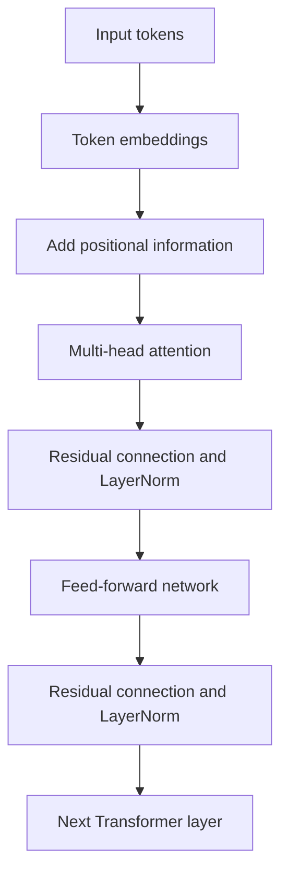

For a decoder-only model such as GPT:

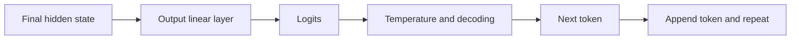

## 2. Tokens and Embeddings

Transformers do not directly understand words. Text is split into tokens, and each token gets an integer ID.

```text
"I love dogs"
       ↓
["I", "love", "dogs"]
       ↓
[101, 2293, 6077]  # illustrative IDs
```

The IDs are vocabulary positions. An embedding table converts each ID into a vector:

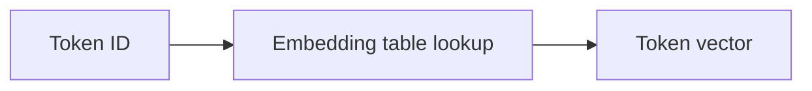

## 3. Position Information

Attention alone does not know token order. The model adds position information to each token embedding.

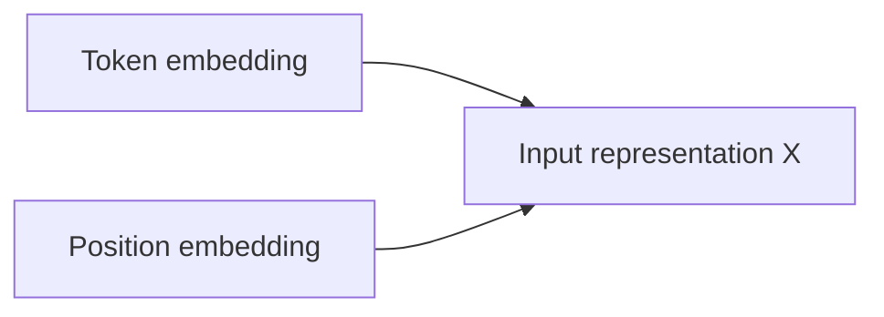

For BERT, token-type information is added too:

$$
X = TokenEmbedding + PositionEmbedding + TokenTypeEmbedding
$$

## 4. Self-Attention

Self-attention lets each token compare itself with other tokens in the same sequence and find useful context.

Example: in `"The dog is hungry because it is tired"`, the representation of `it` can use information from `dog`.

$$
Attention(Q,K,V) = Softmax\left(\frac{QK^T}{\sqrt{d_k}}\right)V
$$

Simple mental model:

```text
QKᵀ       → Which tokens are relevant?
Softmax   → How much should each token matter?
× V       → What information should be collected?
```

## 5. Query, Key, and Value

Given the input matrix `X`, the model creates three projections:

$$
Q = XW_Q, \qquad K = XW_K, \qquad V = XW_V
$$

- `WQ`, `WK`, and `WV` are trainable weight matrices.
- `Q`, `K`, and `V` are computed during the forward pass.
- The model is not given separate Query, Key, or Value datasets.

The architecture defines their roles:

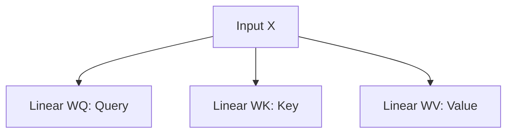

Useful intuition:

- **Query:** What information am I looking for?
- **Key:** What kind of information do I contain?
- **Value:** What information should I provide?

These are learning aids, not literal meanings stored by the model.

Training updates `WQ`, `WK`, and `WV` through loss, backpropagation, and an optimizer:

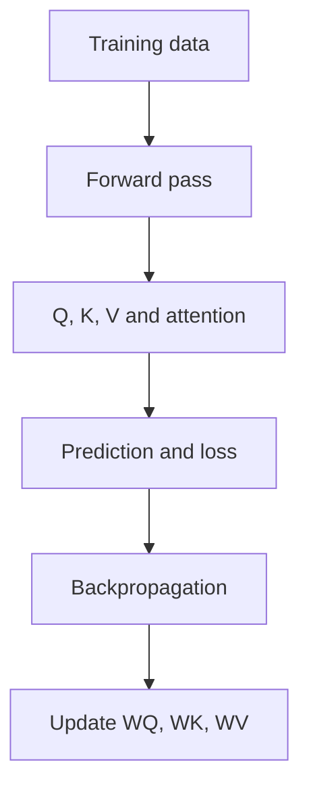

## 6. Attention Scores and Values

`QKᵀ` produces a relevance score between tokens. Dividing by $\sqrt{d_k}$ keeps the scores stable. Softmax changes the scores into weights, and the weights are multiplied by `V`.

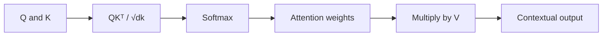

`QKᵀ` does not predict the next token. The final output layer produces vocabulary logits.

## 7. Multi-Head Attention

Several attention heads work in parallel. Each head has its own learned projections and may learn a different relationship.

If the hidden size is 768 and there are 12 heads:

$$
head\_size = 768 / 12 = 64
$$

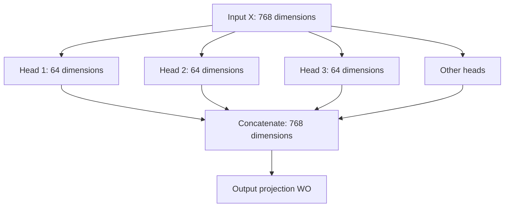

For head $i$:

$$
Q_i = XW_{Q_i}, \qquad K_i = XW_{K_i}, \qquad V_i = XW_{V_i}
$$

Head roles are learned, not manually assigned.

## 8. Normal and Causal Self-Attention

In normal encoder self-attention, every token can see every other token:

```text
        I    love   dogs
I       ✓     ✓      ✓
love    ✓     ✓      ✓
dogs    ✓     ✓      ✓
```

In causal self-attention, a token can see itself and earlier tokens, but not future tokens:

```text
        I    love   dogs
I       ✓     ✗      ✗
love    ✓     ✓      ✗
dogs    ✓     ✓      ✓
```

The mask is used in decoder-only autoregressive models such as GPT.

## 9. Causal Masking

Causal masking prevents the model from seeing the answer while predicting it. The mask is applied to attention scores, after `QKᵀ` and before Softmax. It is not applied directly to `Q`, `K`, or `V`.

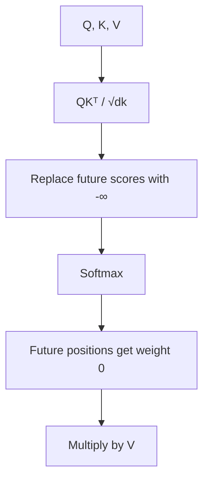

$$
MaskedAttention(Q,K,V) = Softmax\left(\frac{QK^T + Mask}{\sqrt{d_k}}\right)V
$$

For example:

```text
[2.0, -∞, -∞] → [1.0, 0.0, 0.0]
```

## 10. Attention Softmax vs Final Softmax

These Softmax operations have different jobs.

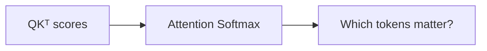

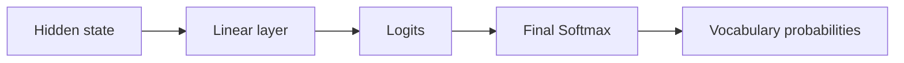

Attention Softmax decides how much to attend to each token. Final Softmax gives probabilities for possible next tokens.

## 11. Residual Connections and LayerNorm

A residual connection adds the original representation to the transformed output:

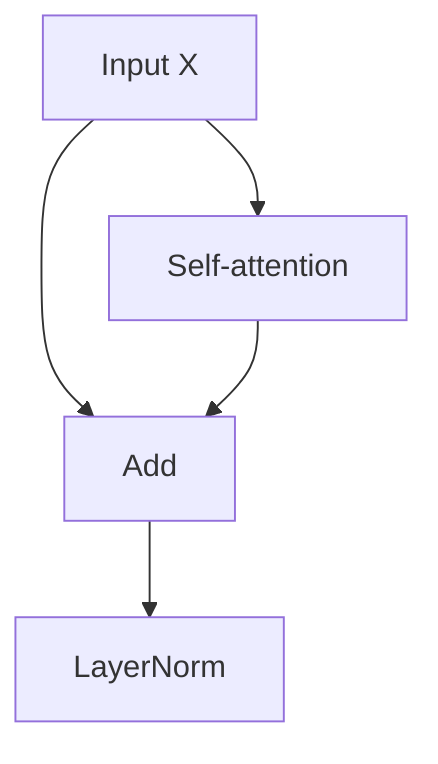

$$
Output = LayerNorm(X + Attention(X))
$$

This lets the network keep useful original information while adding a learned update.

LayerNorm normalizes the hidden features of each token representation. It does not normalize vocabulary probabilities.

$$
x_{norm} = \frac{x - \mu}{\sqrt{\sigma^2 + \epsilon}}
$$

## 12. Feed-Forward Network and GELU

After attention, every token goes through the same small MLP, called the feed-forward network or FFN.

For BERT-base, the common dimensions are 768 → 3072 → 768:

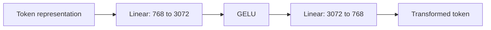

$$
FFN(x) = W_2\,GELU(W_1x+b_1)+b_2
$$

- **Attention:** tokens exchange information with other tokens.
- **FFN:** each token is transformed independently.

GELU is a smooth activation function used in BERT-style FFNs:

$$
GELU(x) = x\Phi(x)
$$

Unlike ReLU, GELU smoothly suppresses negative values instead of making every negative value exactly zero.

## 13. One Complete Encoder Layer

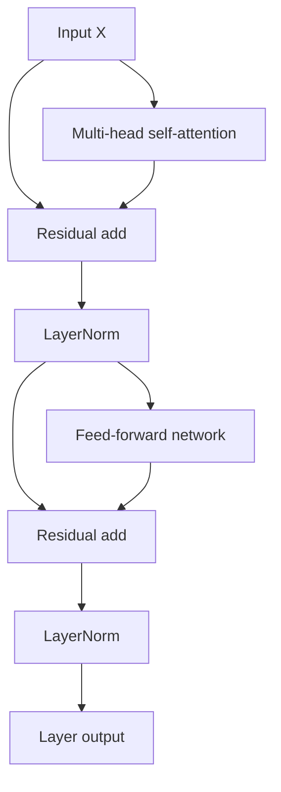

This block is repeated many times. Each layer has its own trainable parameters.

## 14. Encoder, Decoder, and Cross-Attention

### Encoder

An encoder uses unmasked self-attention and creates contextual representations of the input. BERT is an encoder-only model.

### Decoder

A decoder uses causal self-attention to generate tokens from left to right. In an encoder-decoder model, it also uses cross-attention and an FFN.

The original Transformer has both parts:

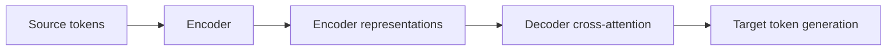

In cross-attention, the decoder provides the Query. The encoder output provides the Keys and Values:

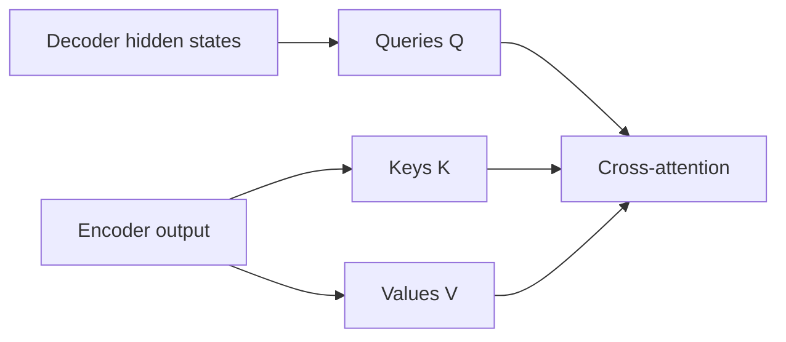

## 15. Autoregressive Generation

At each step, the decoder predicts one next token, appends it, and repeats:

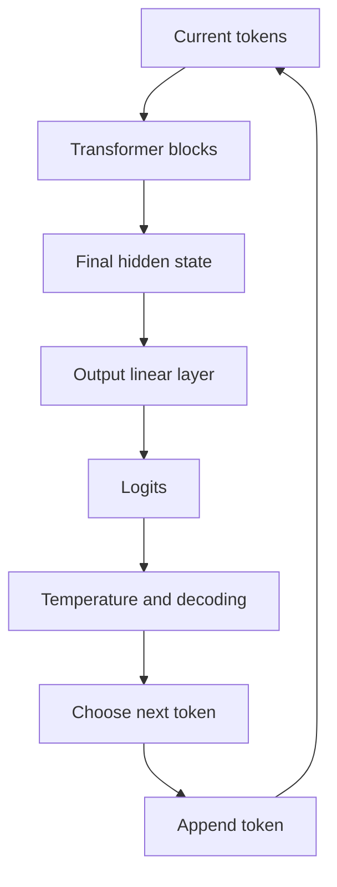

This is called autoregressive generation.

### Temperature

Temperature is applied to logits before the final Softmax:

$$
P(token) = Softmax\left(\frac{logits}{T}\right)
$$

- **Low temperature:** a sharper distribution and less randomness.
- **High temperature:** a flatter distribution and more variety.

Temperature changes randomness; it does not guarantee correctness.

## 16. Context Window and KV Cache

The context window is the maximum number of tokens that can be processed at one time. For longer information, applications may use truncation, chunking, summarization, or RAG.

During generation, previous Key and Value vectors do not need to be calculated again. The model stores them in a KV cache and computes only the new token's projections.

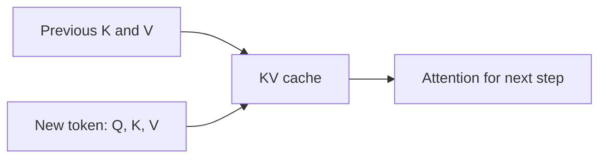

## 17. Final Mental Model

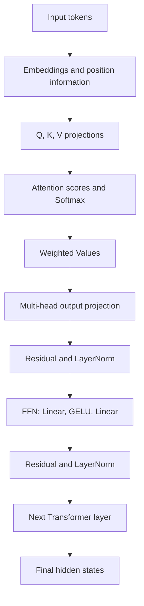

For decoder generation, final hidden states are converted into logits and then into the next token.

## 18. Simple Cheat Sheet

```text
Token IDs       → vocabulary positions
Embeddings      → vectors for token IDs
Position info   → token order
Q and K         → where and how much to look
Mask            → block future tokens
V               → information to collect
Softmax         → convert scores into weights or probabilities
Multi-head      → several learned attention perspectives
Residual        → preserve the original representation
LayerNorm       → stabilize hidden features
FFN             → transform each token independently
Encoder         → understand the complete input
Decoder         → generate tokens from left to right
Cross-attention → decoder uses encoder information
Final linear    → convert hidden states into vocabulary logits
```

## Recommended Implementation Order

1. Single-head self-attention
2. Multi-head attention
3. Causal masking
4. Transformer encoder block
5. Decoder and autoregressive generation
