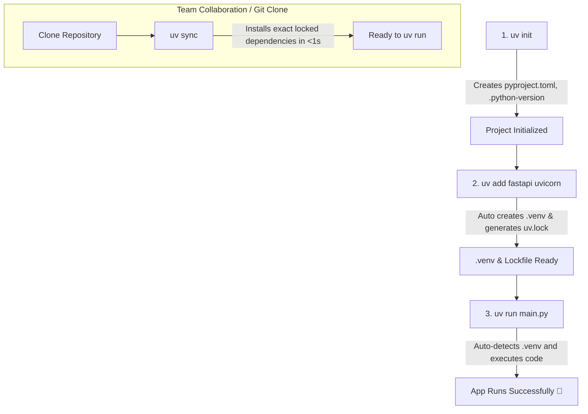
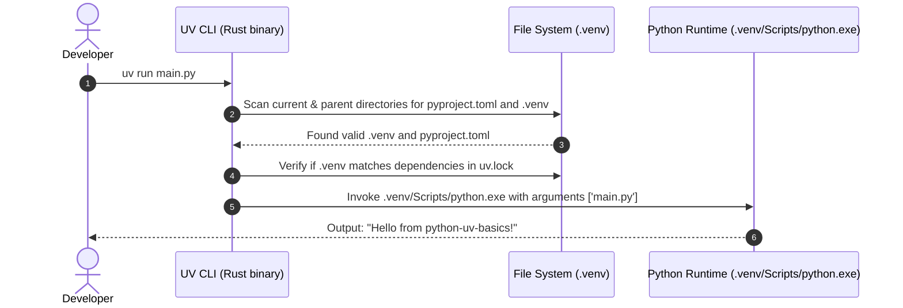

# ⚡ Complete Guide to UV: Modern Python Package & Project Manager

An ultra-fast, modern, and reliable Python package and project manager written in Rust by Astral. It serves as an all-in-one replacement for `pip`, `pip-tools`, `virtualenv`, `poetry`, and `pyenv`.

---

## ❓ Frequently Asked Questions: Why & How It Works

### 1. `uv python .\main.py` ❌ (Why did it fail?)
- **Reason:** `uv python` is strictly dedicated to **managing Python versions and installations** (such as downloading, listing, pinning, or finding Python interpreters). It is **not** meant for executing scripts.
- Because `uv` expected a subcommand (e.g., `install`, `list`, `pin`), passing `.\main.py` triggered the error: `error: unrecognized subcommand '.\main.py'`.

### 2. `uv run python .\main.py` ✅ (Why did it succeed?)
- **Reason:** `uv run <command> [args...]` executes any command or binary within the isolated context of the project's virtual environment (`.venv`).
- Here, `uv` invoked the `python` binary residing inside `.venv` and passed `.\main.py` as an argument to it.

### 3. `uv run .\main.py` ✅ (Why did this shortcut work?)
- **Reason:** `uv run` has smart interpreter detection! When you pass a `.py` file path directly, `uv` automatically recognizes it as a Python script and executes it using the project's Python interpreter without requiring you to explicitly prefix `python`.

---

## 🔄 End-to-End Project Lifecycle Flow

The typical development lifecycle with `uv` from project creation to execution and team collaboration:



---

### 🪜 Step-by-Step Breakdown

```
[ Step 1: Initialize Project ]
       uv init
          │
          ├──> pyproject.toml  (Project metadata and dependencies declaration)
          ├──> .python-version (Pinned Python version, e.g., 3.13)
          └──> main.py         (Starter boilerplate file)

[ Step 2: Add Dependencies ]
       uv add fastapi uvicorn
          │
          ├──> Updates pyproject.toml (Adds to dependencies list)
          ├──> Generates uv.lock      (Deterministic lock of all sub-dependencies)
          └──> Auto-creates .venv/    (Installs all packages in isolation)

[ Step 3: Run Scripts or Services ]
       uv run main.py
          │
          ├──> UV auto-discovers .venv in the workspace
          └──> Executes using the virtual environment Python (No activation needed!)

[ Step 4: Synchronize (Team / CI / Production) ]
       uv sync
          │
          └──> Reads uv.lock and builds the identical environment in milliseconds
```

---

## 🧠 Under-the-Hood: How `uv run` Works Without Manual Activation

When you run a command using `uv run`, you do **not** need to manually activate `.venv` (e.g., via `.venv\Scripts\activate`). Here is how `uv` handles it under the hood:



1. **Automatic Directory Scanning:** `uv` traverses the directory tree to find `pyproject.toml` and `.venv`.
2. **Lockfile & Environment Verification:** If you modified `pyproject.toml` and forgot to sync, `uv run` automatically updates the environment before execution.
3. **Targeted Subprocess Execution:** It executes the target binary with the appropriate environment variables (`VIRTUAL_ENV` and modified `PATH`) without polluting your global shell session.

---

## 🚀 Comprehensive Command Reference

---

### 1️⃣ Project Management

| Command | Description |
|---|---|
| `uv init` | Initializes a new Python project in the current directory (`pyproject.toml`, `README.md`, `.python-version`). |
| `uv init <project-name>` | Creates a new folder and initializes a project inside it. |
| `uv init --app` | Initializes an application project (default). |
| `uv init --lib` | Initializes a Python library/package with `src` layout and build system configuration. |
| `uv sync` | Synchronizes the `.venv` with `pyproject.toml` and `uv.lock` (installs missing and removes extraneous packages). |
| `uv lock` | Resolves dependencies and writes/updates `uv.lock` without installing packages. |
| `uv lock --upgrade` | Upgrades all locked dependencies to their latest compatible versions. |
| `uv tree` | Displays a visual dependency tree of the project. |

---

### 2️⃣ Dependency Management

| Command | Description | Example |
|---|---|---|
| `uv add <package>` | Adds a package to `pyproject.toml` and installs it into `.venv`. | `uv add fastapi uvicorn` |
| `uv add "<package>>=1.0.0"` | Adds a package with a specific version constraint. | `uv add "pandas>=2.0.0"` |
| `uv add --dev <package>` | Adds a development-only dependency (testing, formatting, linting). | `uv add --dev pytest ruff black` |
| `uv add --optional <group> <pkg>` | Adds a package to an optional dependency group (extra). | `uv add --optional docs sphinx` |
| `uv remove <package>` | Removes a dependency from `pyproject.toml` and uninstalls it. | `uv remove fastapi` |
| `uv remove --dev <package>` | Removes a package from the development dependencies group. | `uv remove --dev pytest` |

---

### 3️⃣ Running Code & Tools (`uv run`)

| Command | Description |
|---|---|
| `uv run main.py` | Runs a Python script using the project's virtual environment. |
| `uv run python main.py` | Explicitly runs a script via the Python executable. |
| `uv run uvicorn main:app --reload` | Executes installed CLI binaries (e.g., Uvicorn, Pytest, Flask). |
| `uv run pytest` | Runs the test suite inside the isolated project environment. |
| `uv run --with <pkg> script.py` | Executes a script with an ephemeral package without modifying `pyproject.toml`. |

---

### 4️⃣ One-off & Standalone Tool Execution (`uvx` / `uv tool`)

Execute standalone CLI tools in temporary isolated environments without installing them into your active project:

| Command | Description |
|---|---|
| `uvx ruff check .` | Lints the codebase using Ruff in an isolated sandbox. |
| `uvx ruff format .` | Formats code with Ruff. |
| `uvx marimo edit` | Launches the interactive Marimo notebook editor. |
| `uv tool install <tool>` | Installs a CLI tool globally to the user system. |
| `uv tool list` | Lists all installed global tools. |
| `uv tool run <tool>` | Equivalent to `uvx <tool>`. |

---

### 5️⃣ Python Version Management (`uv python`)

Manage multiple Python versions directly without needing external tools like `pyenv` or manual installers:

| Command | Description |
|---|---|
| `uv python list` | Lists all available, installed, and downloadable Python versions. |
| `uv python install 3.12` | Downloads and installs Python 3.12. |
| `uv python install 3.10 3.11 3.12 3.13` | Installs multiple Python versions in parallel. |
| `uv python pin 3.12` | Pins the project to Python 3.12 by setting `.python-version`. |
| `uv python find` | Displays the absolute path of the active Python interpreter. |
| `uv python uninstall 3.11` | Uninstalls a specific Python version from your system. |

---

### 6️⃣ Virtual Environment Management (`uv venv`)

If you ever need low-level manual virtual environment control:

| Command | Description |
|---|---|
| `uv venv` | Creates a standard `.venv` virtual environment in the current directory (<50ms). |
| `uv venv --python 3.12` | Creates a virtual environment with a specific Python version. |
| `uv venv <env_name>` | Creates a virtual environment with a custom folder name. |

---

### 7️⃣ Pip Compatibility Mode (`uv pip`)

For backward compatibility with legacy `requirements.txt` workflows:

| UV Command | Standard Pip Equivalent | Speed Improvement |
|---|---|---|
| `uv pip install -r requirements.txt` | `pip install -r requirements.txt` | 10x - 100x faster |
| `uv pip install requests` | `pip install requests` | Instant caching |
| `uv pip uninstall requests` | `pip uninstall requests` | Instant |
| `uv pip freeze` | `pip freeze` | Instant |
| `uv pip list` | `pip list` | Instant |
| `uv pip compile requirements.in -o requirements.txt` | `pip-compile requirements.in` | 10x - 50x faster |

---

## ⚖️ Comparison: Traditional Pip Workflow vs Modern UV Workflow

| Workflow Step | 🐢 Traditional Way | ⚡ Modern UV Way |
|---|---|---|
| **1. Install Python** | Manual installer or pyenv | `uv python install 3.13` |
| **2. Initialize Project** | Manual file & folder creation | `uv init` |
| **3. Create Virtualenv** | `python -m venv .venv` | Auto-created on `uv add` or `uv venv` |
| **4. Environment Activation** | `.venv\Scripts\activate` (Required in every terminal session) | ❌ **No activation needed (`uv run`)** |
| **5. Add Dependencies** | `pip install fastapi` + `pip freeze > requirements.txt` | `uv add fastapi` (Auto updates lockfile & `pyproject.toml`) |
| **6. Run Application** | `python main.py` | `uv run main.py` |
| **7. Teammate / CI Setup** | `pip install -r requirements.txt` (Slow, non-deterministic) | `uv sync` (Deterministic, sub-second) |
